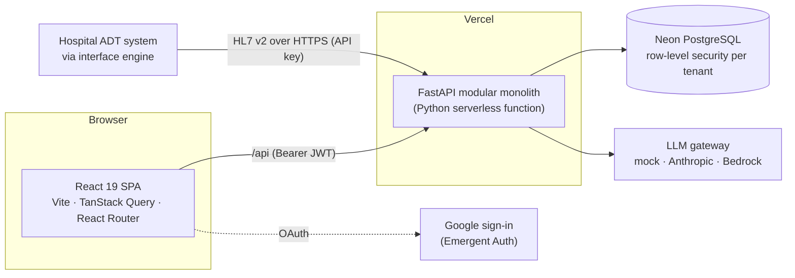

# DischargeFlow

Hospital discharge management: a FastAPI + PostgreSQL backend and a React frontend that coordinate the people and
tasks between "this patient can go home" and the patient actually leaving, with governed AI for discharge summaries,
tenant isolation, encrypted patient data, a tamper-evident audit trail, and FHIR / HL7 interoperability.

**Live:** https://dischargeflow.vercel.app (Vercel + Neon Postgres). It holds synthetic demo data only: there is no
BAA in place, so no real patient data may be entered.

## Contents
- [Features](#features)
- [Architecture](#architecture)
- [Security and compliance](#security-and-compliance)
- [AI](#ai)
- [Interoperability](#interoperability)
- [Running locally](#running-locally)
- [Testing and quality gates](#testing-and-quality-gates)
- [Deployment](#deployment)
- [Project status](#project-status)
- [Documentation](#documentation)

## Features

| Area | What it does |
|---|---|
| **Discharge workflow** | A physician starts a discharge; eight standard tasks are assigned to nurses, pharmacists and physicians by role. The workflow moves `in_progress` ⇄ `pending_approval` as tasks open and close, and completes only when every task is done and the AI summary is approved. The database allows one active discharge per patient. |
| **Tasks** | Per-role task lists with priorities, manual ad-hoc tasks, completion tracking. |
| **Patients** | Patient records with admitted / pending discharge / discharged status, GDPR consent, and right to erasure (crypto-shredding). |
| **AI discharge summaries** | Structured, de-identified generation with grounding warnings, mandatory physician review and edit, and provenance for every model call. |
| **AI assistant** | A tool-calling assistant that looks up patients, tasks, analytics and claims, and *proposes* writes (create task, start discharge, file claim) that the user must confirm. |
| **Insurance claims** | Claims per patient with status tracking (pending → submitted → accepted / denied → paid) and reports. |
| **Notifications** | In-app notifications by role, pushed live over Server-Sent Events, with polling as the fallback. |
| **Analytics** | Dashboard KPIs and task distribution; for admins, operational metrics (throughput, approval wait time, task SLA breaches) and AI insights that explain aggregate metrics. |
| **Administration** | User role management, integration API keys, audit log with chain verification. |
| **Interoperability** | Read-only FHIR R4 API; inbound HL7 v2 ADT (A01 admit, A03 discharge). |

Roles: **physician**, **nurse**, **pharmacist**, **admin**. New users join as nurse; an admin promotes them. The
first admin has to be set in the database (`UPDATE users SET role = 'admin' WHERE user_id = '…'`).

## Architecture

A **modular monolith**: one FastAPI service whose packages each own their tables and HTTP routes, one PostgreSQL
database, and a single-page React app. The design and its trade-offs are in
[ADR-001](docs/architecture/ADR-001-production-architecture.md).



| Module (`backend/app/`) | Responsibility |
|---|---|
| `core` | Config, database sessions (one transaction per request), tenancy and RLS, PHI encryption, security, migrations, logging |
| `identity` | Users, sessions and refresh tokens, role → permission mapping, integration API keys |
| `patients` | Patient records, consent, erasure |
| `discharge` | Workflow state machine and tasks |
| `ai` | LLM gateway, versioned prompts, de-identification, summaries, grounding checks, evals, insights |
| `chatbot` | Tool-calling assistant with confirm-before-write actions |
| `insurance` | Claims |
| `notifications` | In-app notifications and the SSE stream |
| `analytics` | Dashboard and operational metrics |
| `audit` | Hash-chained, append-only audit log |
| `interop` | FHIR R4 (read-only) and HL7 v2 ADT (inbound) |

Module boundaries are enforced in CI by `lint-imports` (`backend/.importlinter`). The frontend has one URL per
screen (`/dashboard`, `/patients/:id`, `/workflows/:id`, `/tasks`, `/insurance`, `/assistant`, `/analytics`,
`/insights`, `/admin`), lazy-loaded, with all server state in TanStack Query.

**Tech stack:** Python 3.12, FastAPI, SQLAlchemy 2 (async), Alembic, PostgreSQL 16 (SQLite for local dev and tests);
React 19, Vite, TanStack Query, React Router, Tailwind + shadcn/ui, Recharts; Anthropic SDK (Claude via the
Anthropic API or Amazon Bedrock); Terraform; GitHub Actions.

## Security and compliance

- **Sessions:** 15-minute access tokens kept in memory only; a rotating, httpOnly, SameSite=Strict refresh cookie
  with reuse detection and server-side revocation. Roles and revocation are read from the database on each request
  (30 s cache), so a role change or logout applies within seconds.
- **Permissions:** endpoints declare a permission (`requires("workflow:manage")`); a `role_permissions` table maps
  roles to permissions.
- **Tenant isolation:** every tenant-scoped table is filtered by PostgreSQL row-level security through a
  non-bypass application role.
- **PHI encryption:** patient name, date of birth, diagnosis and MRN, and discharge summary text, are encrypted with
  AES-256-GCM under a per-patient data key wrapped by a key-encryption key. Erasure destroys the data key. The MRN is
  findable only through a keyed HMAC blind index.
- **Audit:** an append-only, hash-chained audit log (database triggers block UPDATE and DELETE); `GET
  /api/audit/verify` recomputes the chain.
- **Logging:** structured JSON logs with request, tenant and user ids, and a PHI scrubber as a backstop. Patient
  fields, request bodies, prompts and model output are never logged.

**Not yet in place** (planned for the AWS phase): KMS for the key-encryption key, Cognito with MFA, and a BAA with a
cloud and model provider. Until then the deployment is for synthetic data only.

## AI

All model calls go through one gateway (`ai/llm.py`) with three adapters: a deterministic **mock** (tests, CI,
offline development, and production today), **Anthropic**, and **Bedrock**. Selected with `LLM_PROVIDER`.

- **De-identification:** names become tokens, contact details and dates are scrubbed, and only the fields a prompt
  needs are sent (age instead of date of birth, length of stay instead of dates). Output is re-identified.
- **Structured output:** summaries are JSON validated against a schema, retried once, then fail visibly.
- **Grounding:** medications and diagnoses not present in the input are flagged to the approving physician.
- **Human in the loop:** no AI text reaches a record without physician approval; the edit diff and similarity are
  kept as a quality signal.
- **Provenance:** every call records model, prompt version and hash, input hash, tokens and latency, never the text.
- **Evals:** a golden set of synthetic patients runs in CI and fails on any hallucinated fact, PHI leak or low
  coverage. Prompts are versioned files whose hashes are pinned in tests.
- **Assistant safety:** tool results are wrapped as untrusted data, and the model can only propose writes; the user
  confirms each one (single use, 10-minute expiry, permission re-checked).

## Interoperability

- **FHIR R4 (read-only)** at `/api/fhir/R4`: `Patient`, `Encounter`, `Task`, `DocumentReference` (approved
  summaries) and a `CapabilityStatement` at `/metadata`, using the same bearer token and permissions as the app.
- **HL7 v2 ADT (inbound)** at `POST /api/hl7/adt`: an interface engine forwards each message over HTTPS with an
  integration API key and gets the HL7 ACK back. **A01** admits a new MRN or readmits a discharged patient; **A03**
  completes the discharge if the workflow allows it, and otherwise answers AE with the reason and notifies
  physicians. Resent messages replay their original ACK. Admins create and revoke API keys at
  `/api/integrations/clients`. There is no MLLP listener: the interface engine bridges MLLP to HTTPS.

## Running locally

Requirements: Python 3.12+, Node 22. Local development uses SQLite, so no database server is needed.

```bash
# backend
cd backend
python -m venv venv
venv\Scripts\activate            # Windows; source venv/bin/activate elsewhere
pip install -r requirements.txt
python -m app.cli migrate        # schema + PHI encryption backfill
python -m app.cli seed           # optional demo patients
python -m uvicorn server:app --port 8000 --reload
```

```bash
# frontend
cd frontend
npm ci
npm run dev                      # http://localhost:3000, proxies /api to :8000
```

Sign-in uses Google through Emergent Auth. For local testing without OAuth, set `ENABLE_DEV_LOGIN=true` (development
and test only) to enable `POST /api/auth/dev-login`, which the Playwright tests use.

**Full stack with Docker:** `docker compose up --build` starts PostgreSQL, runs migrations once, then the backend
(seeded with demo patients) and the frontend.

Configuration is read from environment variables (`backend/app/core/config.py`). In production, `DATABASE_URL`,
`PHI_KEK` (base64 of 32 bytes) and `JWT_SECRET` are required. The full list is in [CLAUDE.md](CLAUDE.md#configuration-appcoreconfigpy).

## Testing and quality gates

```bash
cd backend
python -m pytest                 # in-memory SQLite; set TEST_DATABASE_URL to run against Postgres
ruff check .
lint-imports                     # module boundary contracts
mypy                             # type check
python -m app.ai.evals           # golden-set AI evals (mock adapter)

cd ../frontend
npm test                         # Vitest
npx eslint .
npx playwright test              # end-to-end: starts the backend (mock AI, dev login) and the built app
```

CI (`.github/workflows/ci.yml`) runs all of the above on every push and pull request, with the backend suite on both
SQLite and a Postgres 16 service (including row-level-security tests and a migration upgrade/downgrade/drift check),
plus `pip-audit`, `npm audit`, a Trivy image scan, `terraform validate` and CodeQL. Dependabot covers pip, npm,
GitHub Actions, Docker and Terraform.

## Deployment

**Today: Vercel + Neon.** `vercel.json` serves the built frontend and runs `backend/server.py` as a Python function.
Neon (through the Vercel integration) provides `DATABASE_URL`, with a database branch per preview deployment.
`AUTO_MIGRATE=true` migrates on the first request of each process under an advisory lock, because Vercel has no
release step.

**Prepared, not applied: AWS.** [`infra/`](infra/README.md) holds Terraform for staging and production (VPC, RDS
PostgreSQL, ECS Fargate, ALB, CloudFront + WAF, Secrets Manager, alarms, GitHub OIDC deploy role), and
`.github/workflows/deploy.yml` deploys with a manual production gate. It stays dormant until the repository variable
`AWS_DEPLOY_ENABLED` is `true`; the project has no AWS account yet. [Runbooks](docs/runbooks/README.md) cover deploys
and rollbacks, database restore, secret rotation and AI incidents. `k8s/` has equivalent Kubernetes manifests.

## Project status

The plan in [ADR-001](docs/architecture/ADR-001-production-architecture.md) is implemented through Phase 6:

| Phase | Scope | Status |
|---|---|---|
| 1 | Modular backend, PostgreSQL, Alembic, test suite | Done |
| 2 | Sessions, DB-backed permissions, tenant RLS, PHI encryption, audit chain | Done; Cognito/MFA and KMS deferred to AWS |
| 3 | Governed AI layer: gateway, de-identification, structured summaries, evals, assistant | Done; async SQS worker deferred to AWS |
| 4 | Terraform for AWS, deploy pipeline, observability, runbooks | Written and validated; not applied |
| 5 | Vite frontend, TanStack Query, URL routes, Playwright, FHIR R4, AI insights | Done |
| 6 | SSE notifications, operational metrics, import/type gates, HL7 v2 ADT | Done |

Still waiting on an AWS account (and a BAA, for real data): Cognito with MFA, KMS, the outbox → SQS → worker path for
AI jobs, shared caches, and applying `infra/`. Production runs the AI on the mock adapter until a provider is chosen.

## Documentation

| Document | Contents |
|---|---|
| [docs/architecture/ADR-001-production-architecture.md](docs/architecture/ADR-001-production-architecture.md) | Architecture decision, options considered, phased plan and what each phase delivered |
| [docs/api.md](docs/api.md) | API endpoints by module, with the permission each requires |
| [CLAUDE.md](CLAUDE.md) | Developer guide: commands, configuration, conventions for every module |
| [memory/PRD.md](memory/PRD.md) | Product requirements and personas |
| [infra/README.md](infra/README.md) | AWS Terraform layout and first-apply steps |
| [docs/runbooks/](docs/runbooks/README.md) | Operational runbooks |
| [frontend/README.md](frontend/README.md) | Frontend commands |

Interactive OpenAPI docs are served by FastAPI at http://localhost:8000/docs on a locally running backend.
