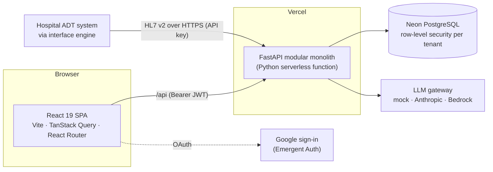

<div align="center">


# DischargeFlow

**Hospital discharge management, from "ready to go home" to "gone home".**

Coordinated discharge workflows · physician-approved AI summaries · encrypted patient data · FHIR & HL7 interoperability

[](https://github.com/ftaakash/DischargeFlow/actions/workflows/ci.yml)


[**Live demo**](https://dischargeflow.vercel.app) · [Architecture](#-architecture) · [API reference](docs/api.md) · [ADR-001](docs/architecture/ADR-001-production-architecture.md) · [Developer guide](CLAUDE.md)

</div>

> [!IMPORTANT]
> The live deployment holds **synthetic demo data only**. There is no BAA with a cloud or model provider yet, so no
> real patient data may be entered.

---

## ✨ Highlights

<table>
<tr>
<td width="33%" valign="top">

### 🩺 Discharge workflow
A physician starts a discharge and eight standard tasks fan out to nurses, pharmacists and physicians. The workflow
tracks itself (`in_progress` ⇄ `pending_approval`) and completes only when every task is done and the summary is
approved.

</td>
<td width="33%" valign="top">

### 🤖 Governed AI
De-identified, structured discharge summaries with grounding warnings, mandatory physician approval, per-call
provenance and golden-set evals in CI. A tool-calling assistant proposes writes that the user must confirm.

</td>
<td width="33%" valign="top">

### 🔐 Security by default
Tenant isolation through Postgres row-level security, AES-256-GCM encryption of patient identifiers with
crypto-shredding, rotating sessions, and a hash-chained, append-only audit log.

</td>
</tr>
<tr>
<td valign="top">

### 🔗 Interoperability
A read-only FHIR R4 API and an inbound HL7 v2 ADT feed: A01 admits, A03 discharges, and every message gets a proper
ACK.

</td>
<td valign="top">

### 📊 Analytics & insights
Live KPIs for everyone. Admins also get throughput, approval wait times, task SLA breaches, and AI explanations
built from aggregates only.

</td>
<td valign="top">

### ⚡ Live updates
In-app notifications by role, pushed over Server-Sent Events, with polling as the fallback.

</td>
</tr>
</table>

<details>
<summary><b>All features</b></summary>

| Area | What it does |
|---|---|
| **Discharge workflow** | Physician-initiated workflows with eight role-assigned tasks; status moves with open tasks; completion needs every task done and an approved AI summary. The database allows one active discharge per patient. |
| **Tasks** | Per-role task lists with priorities, manual ad-hoc tasks, completion tracking. |
| **Patients** | Records with admitted / pending discharge / discharged status, GDPR consent, and right to erasure (crypto-shredding). |
| **AI discharge summaries** | Structured, de-identified generation with grounding warnings, physician review and edit, and provenance for every model call. |
| **AI assistant** | Looks up patients, tasks, analytics and claims; *proposes* writes (create task, start discharge, file claim) that the user confirms. |
| **Insurance claims** | Claims per patient, tracked pending → submitted → accepted / denied → paid, with reports. |
| **Notifications** | Role-routed in-app notifications delivered live over SSE. |
| **Analytics** | Dashboard KPIs and task distribution; operational metrics and AI insights for admins. |
| **Administration** | User roles, integration API keys, audit log with chain verification. |
| **Interoperability** | Read-only FHIR R4; inbound HL7 v2 ADT (A01, A03). |

**Roles:** physician, nurse, pharmacist and admin. New users join as nurse and an admin promotes them. The first admin
is set in the database: `UPDATE users SET role = 'admin' WHERE user_id = '…'`.

</details>

---

## 🏗 Architecture

A **modular monolith**: one FastAPI service whose packages each own their tables and routes, one PostgreSQL database,
and a single-page React app. The decision and its trade-offs are recorded in
[ADR-001](docs/architecture/ADR-001-production-architecture.md).



| Module | Responsibility |
|---|---|
| `core` | Config, one transaction per request, tenancy and RLS, PHI encryption, security, migrations, logging |
| `identity` | Users, sessions and refresh tokens, role → permission mapping, integration API keys |
| `patients` | Patient records, consent, erasure |
| `discharge` | Workflow state machine and tasks |
| `ai` | LLM gateway, versioned prompts, de-identification, summaries, grounding, evals, insights |
| `chatbot` | Tool-calling assistant with confirm-before-write actions |
| `insurance` | Claims |
| `notifications` | In-app notifications and the SSE stream |
| `analytics` | Dashboard and operational metrics |
| `audit` | Hash-chained, append-only audit log |
| `interop` | FHIR R4 (read-only) and HL7 v2 ADT (inbound) |

Module boundaries are enforced in CI by `lint-imports`. The frontend has one URL per screen (`/dashboard`,
`/patients/:id`, `/workflows/:id`, `/tasks`, `/insurance`, `/assistant`, `/analytics`, `/insights`, `/admin`), each
lazy-loaded, with all server state in TanStack Query.

<details>
<summary><b>Tech stack</b></summary>

| Layer | Technology |
|---|---|
| Backend | Python 3.12, FastAPI, SQLAlchemy 2 (async), Alembic |
| Database | PostgreSQL 16 (Neon in production); SQLite for local development and tests |
| Frontend | React 19, Vite, TanStack Query, React Router, Tailwind + shadcn/ui, Recharts |
| AI | Anthropic SDK: Claude via the Anthropic API or Amazon Bedrock, plus a deterministic mock |
| Delivery | GitHub Actions, Vercel, Terraform (AWS, not yet applied), Docker, Kubernetes manifests |

</details>

---

## 🔐 Security and compliance

| Control | How |
|---|---|
| **Sessions** | 15-minute access tokens held in memory only; a rotating httpOnly, SameSite=Strict refresh cookie with reuse detection and server-side revocation. Roles are re-read from the database (30 s cache), so changes apply within seconds. |
| **Permissions** | Each endpoint declares a permission (`requires("workflow:manage")`); a `role_permissions` table maps roles to permissions. See [the API reference](docs/api.md#roles-and-permissions). |
| **Tenant isolation** | PostgreSQL row-level security on every tenant table, through a non-bypass application role. |
| **PHI encryption** | Patient name, date of birth, diagnosis, MRN and summary text use AES-256-GCM with a per-patient data key wrapped by a key-encryption key. Erasure destroys the key. The MRN is findable only through a keyed HMAC blind index. |
| **Audit** | Append-only and hash-chained; database triggers block UPDATE and DELETE; `GET /api/audit/verify` recomputes the chain. |
| **Logging** | Structured JSON with request, tenant and user ids, plus a PHI scrubber as a backstop. Patient fields, request bodies, prompts and model output are never logged. |

> [!NOTE]
> Planned for the AWS phase: KMS for the key-encryption key, Cognito with MFA, and a BAA with a cloud and model
> provider. Until then the deployment is for synthetic data only.

---

## 🤖 AI

Every model call goes through one gateway (`ai/llm.py`) with three adapters: a deterministic **mock** (tests, CI,
offline development, and production today), **Anthropic** and **Bedrock**, chosen with `LLM_PROVIDER`.

- 🕶 **De-identification:** names become tokens, contact details and dates are scrubbed, and only the fields a prompt
  needs are sent (age instead of date of birth, length of stay instead of dates). Output is re-identified.
- 🧱 **Structured output:** summaries are JSON validated against a schema, retried once, then fail visibly.
- 🔎 **Grounding:** medications and diagnoses that aren't in the input are flagged to the approving physician.
- 🧑‍⚕️ **Human in the loop:** no AI text reaches a record without physician approval; the edit diff and similarity are
  kept as a quality signal.
- 🧾 **Provenance:** every call records model, prompt version and hash, input hash, tokens and latency, never the text.
- 🧪 **Evals:** a golden set of synthetic patients runs in CI and fails on any hallucinated fact, PHI leak or low
  coverage. Prompts are versioned files whose hashes are pinned in tests.
- 🛡 **Assistant safety:** tool results are treated as untrusted data, and the model can only propose writes. The user
  confirms each one (single use, 10-minute expiry, permission re-checked).

---

## 🔗 Interoperability

**FHIR R4 (read-only)** at `/api/fhir/R4`: `Patient`, `Encounter`, `Task`, `DocumentReference` (approved summaries) and
a `CapabilityStatement` at `/metadata`, with the same bearer token and permissions as the app.

**HL7 v2 ADT (inbound)** at `POST /api/hl7/adt`: an interface engine forwards each message over HTTPS with an
integration API key and gets the HL7 ACK back.

| Event | Result |
|---|---|
| **A01** admit | Creates the patient, or readmits a discharged one (AE if already admitted) |
| **A03** discharge | Completes the discharge if the workflow allows it; otherwise AE with the reason, and physicians are notified |
| Resent message | The original ACK is replayed and nothing is applied twice |

Admins create and revoke API keys at `/api/integrations/clients`. There is no MLLP listener: the interface engine
bridges MLLP to HTTPS. Full contract: [docs/api.md](docs/api.md#hl7-v2-adt).

---

## 🚀 Getting started

**Requirements:** Python 3.12+ and Node 22. Local development uses SQLite, so no database server is needed.

```bash
# Backend
cd backend
python -m venv venv
venv\Scripts\activate            # Windows; source venv/bin/activate elsewhere
pip install -r requirements.txt
python -m app.cli migrate        # schema + PHI encryption backfill
python -m app.cli seed           # optional demo patients
python -m uvicorn server:app --port 8000 --reload
```

```bash
# Frontend
cd frontend
npm ci
npm run dev                      # http://localhost:3000, proxies /api to :8000
```

Or start the full stack in Docker: `docker compose up --build` starts PostgreSQL, runs migrations once, then the
backend (seeded with demo patients) and the frontend.

<details>
<summary><b>Sign-in and configuration</b></summary>

Sign-in uses Google through Emergent Auth. To test locally without OAuth, set `ENABLE_DEV_LOGIN=true` (development and
test only) to enable `POST /api/auth/dev-login`, which the Playwright tests use.

Configuration comes from environment variables (`backend/app/core/config.py`). In production `DATABASE_URL`,
`PHI_KEK` (base64 of 32 bytes) and `JWT_SECRET` are required. The full list is in
[CLAUDE.md](CLAUDE.md#configuration-appcoreconfigpy). Interactive OpenAPI docs are at http://localhost:8000/docs on a
locally running backend.

</details>

---

## 🧪 Testing and quality gates

<details>
<summary><b>Commands</b></summary>

```bash
cd backend
python -m pytest                 # in-memory SQLite; set TEST_DATABASE_URL to run against Postgres
ruff check .
lint-imports                     # module boundary contracts
mypy                             # type check
python -m app.ai.evals           # golden-set AI evals (mock adapter)

cd ../frontend
npm test                         # Vitest
npx eslint .
npx playwright test              # end to end: starts the backend (mock AI, dev login) and the built app
```

</details>

Every push and pull request runs:

| Backend | Frontend | Platform |
|---|---|---|
| pytest on SQLite **and** Postgres 16, including RLS tests and a migration upgrade/downgrade/drift check | Vitest | Trivy image scan |
| ruff, `lint-imports`, mypy | ESLint | `terraform validate` |
| Golden-set AI evals | Vite build | CodeQL |
| `pip-audit` | `npm audit`, Playwright E2E | Dependabot (pip, npm, Actions, Docker, Terraform) |

---

## ☁️ Deployment

**Today: Vercel + Neon.** `vercel.json` serves the built frontend and runs `backend/server.py` as a Python function.
Neon, connected through the Vercel integration, provides `DATABASE_URL` and a database branch per preview deployment.
`AUTO_MIGRATE=true` migrates on the first request of each process under an advisory lock, because Vercel has no
release step.

**Prepared, not applied: AWS.** [`infra/`](infra/README.md) holds Terraform for staging and production (VPC, RDS
PostgreSQL, ECS Fargate, ALB, CloudFront + WAF, Secrets Manager, alarms, GitHub OIDC deploy role).
`.github/workflows/deploy.yml` deploys with a manual production gate and stays dormant until the repository variable
`AWS_DEPLOY_ENABLED` is `true`; the project has no AWS account yet. [Runbooks](docs/runbooks/README.md) cover deploys
and rollbacks, database restore, secret rotation and AI incidents. `k8s/` has equivalent Kubernetes manifests.

---

## 🗺 Project status

The plan in [ADR-001](docs/architecture/ADR-001-production-architecture.md) is implemented through Phase 6.

| | Phase | Scope | Status |
|---|---|---|---|
| ✅ | 1 | Modular backend, PostgreSQL, Alembic, test suite | Done |
| ✅ | 2 | Sessions, DB-backed permissions, tenant RLS, PHI encryption, audit chain | Done; Cognito/MFA and KMS deferred to AWS |
| ✅ | 3 | Governed AI: gateway, de-identification, structured summaries, evals, assistant | Done; async SQS worker deferred to AWS |
| 🟡 | 4 | Terraform for AWS, deploy pipeline, observability, runbooks | Written and validated; not applied |
| ✅ | 5 | Vite frontend, TanStack Query, URL routes, Playwright, FHIR R4, AI insights | Done |
| ✅ | 6 | SSE notifications, operational metrics, import/type gates, HL7 v2 ADT | Done |

⏳ **Waiting on an AWS account (and a BAA, for real data):** Cognito with MFA, KMS, the outbox → SQS → worker path for
AI jobs, shared caches, and applying `infra/`. Production runs the AI on the mock adapter until a provider is chosen.

---

## 📚 Documentation

| Document | Contents |
|---|---|
| 🏛 [ADR-001](docs/architecture/ADR-001-production-architecture.md) | Architecture decision, options considered, phased plan and what each phase delivered |
| 🔌 [API reference](docs/api.md) | Every endpoint with the permission it requires, and the HL7 ACK contract |
| 🛠 [CLAUDE.md](CLAUDE.md) | Developer guide: commands, configuration, conventions for every module |
| 📋 [PRD](memory/PRD.md) | Product requirements, personas and backlog |
| ☁️ [infra/README.md](infra/README.md) | AWS Terraform layout and first-apply steps |
| 🚨 [Runbooks](docs/runbooks/README.md) | Deploys, restores, secret rotation, AI incidents |
| 🎨 [frontend/README.md](frontend/README.md) | Frontend commands |

<div align="center">
<br />
<sub>Built by <a href="https://github.com/ftaakash">ftaakash</a></sub>
</div>
