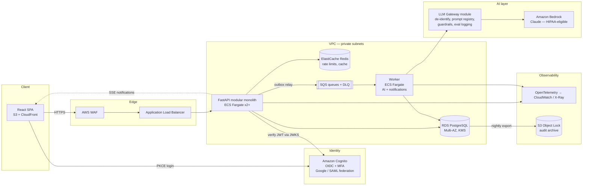

# ADR-001: Production Architecture for DischargeFlow

**Status:** Proposed
**Date:** 2026-10-17
**Deciders:** Aakash (ftaakash), project owner
**Supersedes:** the "Proposed System Architecture" and "Design Trade-offs" sections of `project_implementation_plan.md`. That document was written before anyone audited the repo: it assumes a Node stack and recommends microservices.

---

## Context

### Where the system is today
DischargeFlow works as a demo, but four things keep it from running in production:

| Area | Current state | Why it blocks production |
|---|---|---|
| Data | `AsyncMongoMockClient` (in-memory) is hard-coded in `server.py`, even when `MONGO_URL` is set | All data, including the audit log, is lost on every restart or Vercel cold start. Lazy re-seeding hides the problem. |
| Auth | Emergent's hosted OAuth exchanges a session for a self-minted HS256 JWT that lives 7 days, with the role embedded. The default `JWT_SECRET` is in source. The token is kept in `localStorage`. | Revoking or changing a role takes up to 7 days. Anyone can forge tokens if the default secret ships. `localStorage` is exposed to XSS. The service is tied to a third-party demo host. |
| AI | `emergentintegrations` is imported but missing from `requirements.txt` and calls Gemini through the Emergent proxy. Full PHI goes into the prompt. The chatbot is a keyword `if/elif` chain. | The summary endpoint always returns 500 as shipped. PHI goes to a vendor with no BAA. Nothing evaluates or audits AI output, and nothing protects against prompt injection. |
| Code | A single 1,600-line `server.py`. The CORS middleware is registered twice. Each frontend component builds its own API URL. CI only runs `py_compile` and `npm run build`. | It can't be tested, ownership boundaries are unclear, and regressions surface in production. |

### Forces
- **Domain:** clinical workflow plus PHI. Any production design must cover HIPAA (encryption, audit, least privilege, BAAs) and responsible AI (a human approves every AI output, AI output is traceable, PHI is minimized).
- **Target audience:** the Optum Technology Development Program (Software Engineering Associate, 2027). The JD stresses: *"Integrate AI into workflows"*, *"Use APIs and frameworks to create scalable AI solutions"*, *"Build and optimize prompts"*, *"Ensure responsible and compliant use of AI"*, cloud (AWS/Azure/GCP), Git and CI/CD pipelines, Agile, and *"building quality into every output"*. Optum's stated mission is *connecting a disconnected health system*, which points to interoperability (FHIR).
- **Team and budget:** one developer, a student budget, a few months. The architecture has to stay operable by one person, and the cost has to drop to near zero while it sits idle.
- **Scale:** a hospital pilot means hundreds of users and thousands of patients, not millions. Correctness, auditability and recoverability matter far more than horizontal scale.

### Non-functional requirements (targets)
| NFR | Target |
|---|---|
| Availability | 99.5% for the pilot (multi-AZ database, at least 2 API tasks) |
| Latency | p95 under 300 ms for CRUD. AI summary runs async and should be ready in under 30 s. |
| Durability | RPO 5 min (point-in-time recovery), RTO 1 h |
| Security | TLS 1.2+, KMS encryption at rest, MFA for admin/physician, every PHI read and write audited |
| Auditability | Append-only audit log retained 6 years (HIPAA documentation retention) |
| AI | No AI text reaches a patient record without physician approval. Every generation records the model, prompt version, inputs hash and approver. |

---

## Decision

Rebuild DischargeFlow as a **modular monolith on AWS, backed by PostgreSQL, with one async worker for AI and notification jobs and an AI layer that is provider-agnostic and governed**. Deploy it with Terraform and GitHub Actions to ECS Fargate.



### Components

**1. Backend: a modular monolith (FastAPI)**
Split `server.py` into domain packages that share one deployable unit and one database, each module owning its own tables:

```
backend/app/
  core/          config (pydantic-settings), db session, security, logging, otel
  identity/      users, roles, Cognito JWT verification, RBAC policies
  patients/      admission, census, consent, erasure
  discharge/     workflows, tasks, state machine
  ai/            gateway, prompt registry, de-identification, evals, summary + assistant services
  insurance/     claims, status transitions, reports
  notifications/ outbox, SSE stream, email/SMS adapters
  audit/         append-only audit writer + query API
  interop/       FHIR R4 mappers (Patient, Encounter, Task, DocumentReference, Claim)
  analytics/     read-model queries / materialized views
  worker.py      SQS consumer entrypoint (same image, different command)
```
Each module exposes `router.py` (HTTP), `service.py` (business logic), `repository.py` (SQLAlchemy) and `schemas.py` (Pydantic). Modules call each other only through `service.py`; an `import-linter` contract enforces this, so a module can be pulled out into its own service later if load justifies it.

**2. Data: PostgreSQL 16 on RDS (Multi-AZ)**
- SQLAlchemy 2.0 (async) with **Alembic** migrations, run as a one-off ECS task before each deploy.
- The discharge workflow becomes an explicit **state machine** (`admitted → pending_discharge → ready → discharged`), guarded by transactions. "Can't complete while tasks are open" becomes a DB-backed invariant instead of an API check.
- `audit_events` is append-only: the app role gets INSERT and SELECT only, with no UPDATE or DELETE grants. A hash chain (`prev_hash`) makes tampering detectable. A nightly job exports it to S3 with Object Lock.
- PHI columns (name, DOB, MRN) use KMS envelope encryption at the application layer on top of RDS encryption at rest. Erasure (`DELETE /patients/{id}/data`) becomes crypto-shredding plus pseudonymization, so audit references stay valid.
- **Transactional outbox:** domain events (`WorkflowInitiated`, `SummaryRequested`, `ClaimStatusChanged`) are written in the same transaction as the state change. A relay publishes them to SQS, so no event is lost and none is sent for a transaction that rolled back.
- Every table carries a `tenant_id` (one hospital per tenant). PostgreSQL Row-Level Security enforces it from day one, which costs little now and is painful to add later.

**3. Identity: Amazon Cognito (OIDC)**
- Authorization Code + PKCE from the SPA. Google is federated now, and hospital SAML (e.g. Entra ID) can be added later without changing code.
- Access tokens last 15 minutes and refresh tokens are rotated. The SPA keeps tokens in memory, plus a refresh cookie (httpOnly, `SameSite=Strict`) set through a small `/auth/refresh` endpoint. Nothing goes in `localStorage`.
- **Roles stay in the database, not in the token.** The token proves identity; on each request the API loads `role` and `tenant_id` from Postgres, cached in Redis for 60 s. A role change takes effect within a minute.
- MFA is required for `admin` and `physician`.
- RBAC moves into a policy table (`role → permission`), and endpoints declare permissions (`requires("workflow:initiate")`) instead of role lists.

**4. AI layer: governed, provider-agnostic (the core of this design for the Optum role)**

| Concern | Design |
|---|---|
| Provider | `LLMClient` interface with a **Bedrock (Claude)** adapter by default. Bedrock is HIPAA-eligible under the AWS BAA, so PHI stays inside the AWS account boundary. A local/mock adapter covers tests and offline dev. Use Claude Sonnet 5.5 for summaries and Claude Haiku 5.5 for the assistant's routing and extraction. |
| PHI minimization | A de-identification step replaces direct identifiers with tokens (`[PATIENT_1]`, `[DOB]`) before prompting and re-identifies the response afterwards. Only the fields the prompt needs are sent. |
| Prompt management | Prompts are versioned files in `ai/prompts/` (e.g. `discharge_summary@v3.jinja`) with a typed input schema. Each generation stores `prompt_version`, `model_id`, `input_hash`, token counts and latency. |
| Structured output | The summary is generated as JSON matching a Pydantic schema (sections: hospital course, diagnoses, meds, follow-up, warning signs), validated, then rendered. Invalid output is retried once, then fails visibly. |
| Human in the loop | Keep and strengthen the existing approve step. Summaries are `draft` until a physician approves them, and the approver's edits are diffed and stored. The diff is the main quality signal for evaluation. |
| Async | `POST /ai/summaries` returns `202` with a job id. The worker generates the summary, and the SPA receives the result over SSE. API requests never block on an LLM call. |
| Evaluation | `ai/evals/` holds a golden set of synthetic patients with expected facts. CI runs a fact-coverage and hallucination check (meds and diagnoses not in the input) against the mock or a cheap model on every prompt change, and the PR fails if scores regress. |
| Assistant (chatbot) | Replace keyword matching with **LLM tool calling**. The tools are the existing service functions (`list_patients`, `create_task`, `submit_claim`, …), and each tool call goes through the same RBAC and audit path as HTTP. Write actions return a confirmation card the user must accept, and the model never calls write APIs on its own. Retrieved patient text is wrapped as data, never as instructions (prompt-injection boundary). |
| Guardrails and cost | Per-user and per-tenant rate limits (Redis token bucket), a monthly token budget alarm, and Bedrock Guardrails for PII leakage and denied topics. |
| Insights | `analytics/` exposes discharge bottlenecks (task dwell time by role). An "explain this trend" feature sends **only aggregates, never PHI** to the LLM and returns narrative insights for the admin dashboard. |

**5. Interoperability: FHIR R4**
The `interop/` module maps internal models to FHIR `Patient`, `Encounter`, `Task`, `DocumentReference` (the approved summary) and `Claim`, exposed read-only at `/fhir/R4/...`. An inbound HL7 v2 ADT (admit/discharge) adapter is the documented next step. This puts the JD's "connecting a disconnected health system" into practice.

**6. Frontend**
- One shared `apiClient` with a token refresh interceptor, plus **TanStack Query** for caching and refetching, replacing the 10 copies of the `API` constant.
- URL routes per view (`/patients/:id`, `/workflows/:id`) instead of `activeView` state, so views can be deep-linked and the back button works.
- Remove the `POST /seed` call from `Dashboard.js`. Seeding becomes a CLI command available only in dev and staging.
- Migrate CRA/craco → **Vite**: CRA is no longer maintained.
- Tests: Vitest + React Testing Library for components, Playwright E2E for the critical path (login → initiate discharge → complete tasks → approve summary → discharge).

**7. Delivery: CI/CD and IaC**
- **Terraform** in `infra/` for VPC, RDS, ECS, ALB, WAF, Cognito, SQS, ElastiCache, S3/CloudFront, KMS, Secrets Manager and IAM, with separate `staging` and `prod` workspaces.
- **GitHub Actions**:
  1. PR stage: ruff + mypy, pytest with Testcontainers Postgres (unit + API), ESLint + Vitest, the AI eval suite, CodeQL, `pip-audit` / `npm audit`, Trivy image scan and `terraform plan`.
  2. Main branch: build one image, push it to ECR tagged with the git SHA, run Alembic, deploy to staging, run Playwright smoke tests, then wait for **manual approval** before deploying to prod with ECS rolling deployment and the circuit-breaker auto-rollback.
  3. The AWS deploy role is assumed through GitHub OIDC, so no long-lived keys are stored.
- Branch protection, conventional commits and Dependabot (already present).

**8. Observability and operations**
- Structured JSON logs with a request ID, user ID and tenant ID, and PHI scrubbed by a log filter.
- OpenTelemetry traces API → DB → SQS → worker → Bedrock in CloudWatch/X-Ray.
- RED metrics per endpoint, plus business metrics: median time from initiate to discharge, tasks overdue by role, and AI approval rate and edit distance.
- Alarms: 5xx rate, p95 latency, DLQ depth > 0, token budget at 80% and RDS CPU/storage, routed through SNS to email.
- Runbooks in `docs/runbooks/` for restoring a database, rotating secrets and draining the DLQ.

---

## Options Considered

### Decision 1: Application style

#### Option A: Modular monolith + one worker (**chosen**)
| Dimension | Assessment |
|---|---|
| Complexity | Low–Med: one image, one DB, two process types |
| Cost | Low: 2–3 small Fargate tasks |
| Scalability | API and worker scale independently, which is enough for a multi-hospital pilot |
| Team familiarity | High: same FastAPI codebase, just reorganized |

**Pros:** in-process calls (no distributed transactions), one migration path, simple local dev (`docker compose up`), and enforced module boundaries keep the option to extract services later.
**Cons:** a bad deploy affects every module. Mitigated by staging + smoke tests + auto-rollback.

#### Option B: Microservices (core, insurance, chatbot, notifications, auth), as in `project_implementation_plan.md`
| Dimension | Assessment |
|---|---|
| Complexity | High: 5 deployables, service-to-service auth, distributed tracing needed from day one, saga patterns for cross-service workflows |
| Cost | Med–High: per-service tasks, databases and load balancer rules |
| Scalability | Best per-component scaling, which the current load doesn't need |
| Team familiarity | Low for a single developer |

**Pros:** independent deploys, fault isolation, team autonomy at scale.
**Cons:** discharge completion would need a distributed transaction across tasks, summaries and patient status. One developer can't run five services well, and the scaling benefit only pays off with multiple teams.

#### Option C: Serverless (Lambda + API Gateway) on the current Vercel model
| Dimension | Assessment |
|---|---|
| Complexity | Med: it's cold-start and connection-pool issues with Postgres that cause the complexity (it needs RDS Proxy) |
| Cost | Lowest while idle |
| Scalability | Excellent |
| Team familiarity | Med |

**Pros:** costs nothing when idle.
**Cons:** the current design fights the stateless model, which is the root cause of the mock DB and lazy re-seeding hacks. SSE and long LLM calls fit poorly. Vercel doesn't offer a BAA on standard plans, so PHI can't go there.

### Decision 2: Primary datastore

| | **PostgreSQL on RDS (chosen)** | MongoDB Atlas | DynamoDB |
|---|---|---|---|
| Complexity | Med (migrations) | Low (current code is Mongo-shaped) | High (access-pattern modeling) |
| Integrity | ACID, FKs, constraints, RLS for tenancy | Multi-doc transactions exist, but no FKs or RLS | Limited transactions, no joins |
| Fit for domain | Workflows, tasks, claims and audit are relational, and analytics needs joins and aggregates | Good for flexible documents (chat transcripts) | Good at massive scale, which isn't needed |
| Compliance | HIPAA-eligible under the AWS BAA | BAA available on dedicated tiers | HIPAA-eligible |

Postgres wins on integrity (claims and discharge state), on analytics SQL, and on RLS-based tenant isolation. If chat transcripts need a flexible shape, a `JSONB` column covers it without a second database.

### Decision 3: Identity

| | **Amazon Cognito (chosen)** | Keycloak (self-hosted) | Keep custom JWT |
|---|---|---|---|
| Complexity | Low–Med | High (you run and patch it) | Low |
| Cost | Free tier covers the pilot | A Fargate task plus a DB | Free |
| Features | MFA, federation (Google, SAML), PKCE, token revocation | Richest feature set | None of these, and you write all of it yourself |
| Compliance | HIPAA-eligible | Your responsibility | Your responsibility, and the default secret is a live risk |

### Decision 4: LLM provider path

| | **Bedrock + provider-agnostic gateway (chosen)** | Direct vendor API (Anthropic/OpenAI/Gemini) | Self-hosted open model |
|---|---|---|---|
| PHI handling | Stays inside the AWS account under the BAA | Needs a separate BAA with each vendor | Fully in your control |
| Ops burden | Low | Low | High (GPU, scaling, patching) |
| Model quality | Claude family, swappable | Best per vendor | Lower at a comparable cost |
| Portability | Gateway interface allows swapping | Lock-in unless abstracted | — |

### Decision 5: Compute

| | **ECS Fargate (chosen)** | EKS (reuse `k8s/`) | App Runner / Elastic Beanstalk |
|---|---|---|---|
| Complexity | Low–Med | High (cluster ops, add-ons, upgrades) | Lowest |
| Cost | Pay per task | Control-plane fee plus nodes | Low |
| Fit | Long-running API + SQS worker + one-off migration tasks | Same, plus a portable skill set | Weak support for workers and VPC-private Redis |

The existing `k8s/` manifests stay as a documented alternative. EKS is the better fit once there are several teams. For one developer, Fargate gives the same container workflow without running a cluster.

---

## Trade-off Analysis

1. **Simplicity vs. distributed scaling.** The pilot load fits easily on one API service, while the hardest correctness problems (the discharge invariant, audit consistency, the outbox) are much easier in one database. The trade is accepted: a monolith with enforced boundaries plus a worker, revisited when a module's load or team ownership diverges.
2. **Managed AWS services vs. portability.** Cognito, Bedrock, SQS and RDS create AWS coupling. It's contained behind interfaces (`LLMClient`, `QueuePublisher`, OIDC-standard JWT verification, SQLAlchemy). In return, you get BAA coverage and a lot less to operate. Portability is preserved where it is cheap.
3. **AI capability vs. compliance risk.** Async generation, de-identification, structured output and mandatory approval add latency and code compared with a direct LLM call. In a clinical setting that cost is the point: every AI output can be traced, reviewed and evaluated. The design also shows the JD's "responsible and compliant use of AI" directly.
4. **Cost vs. availability.** Multi-AZ RDS plus two API tasks is the main fixed cost. Staging runs single-AZ and scales to zero tasks overnight with scheduled scaling. Verify actual figures with the AWS Pricing Calculator before committing; this ADR deliberately quotes no prices.
5. **Migration effort.** Moving from Mongo-shaped dicts to SQLAlchemy models is the largest piece of work. It's sequenced first because every other improvement (tests, audit, tenancy) depends on real persistence.

---

## Consequences

**Easier**
- Real persistence: no re-seeding hacks, and the audit trail survives restarts.
- Role revocation takes effect in about a minute, and MFA and hospital SSO can be enabled through configuration.
- Each module can be tested in isolation, and CI catches regressions, including AI quality regressions.
- AI features can be shown, measured and defended: approval rate, edit distance and eval scores per prompt version.
- FHIR endpoints make the system an integration target instead of another data silo.

**Harder**
- Local dev needs Postgres and Redis (`docker compose`), and an AWS account for Bedrock (or the mock adapter).
- Schema changes need Alembic migrations and a backward-compatible deploy order.
- Terraform state and AWS IAM add operational surface area.

**To revisit**
- Extracting `insurance/` into its own service if claim volume or EDI (X12 837/835 clearinghouse) integration requires it.
- EKS if the project gains multiple teams.
- An HL7 v2 ADT inbound feed and a FHIR write API once a partner system exists.
- Moving analytics to a read replica or warehouse if dashboard queries slow down OLTP.

---

## Action Items

Sequenced as Agile increments of roughly two weeks each. Every phase ends deployable.

**Phase 1: Foundation (persistence + structure)** (done 2026-10-17)
1. [x] Restructure `server.py` into `backend/app/<module>/`. Remove the duplicate CORS middleware and the default `JWT_SECRET`.
2. [x] Add SQLAlchemy 2.0 models + Alembic baseline. Replace `AsyncMongoMockClient` with Postgres in `docker-compose.yml`.
3. [x] Remove `POST /seed` from the dashboard and add `python -m app.cli seed` (non-prod only).
4. [x] pytest suite for the discharge state machine, RBAC, claims, chatbot and migrations. Runs on SQLite locally and against a Postgres 16 service container in CI (used instead of Testcontainers: simpler in GitHub Actions, and no Docker needed for local runs). The root `*_test.py` scripts are removed.

**Phase 2: Identity + security** (done 2026-10-18; two items deliberately deferred, noted below)
5. [x] Tokens kept in memory with a rotating refresh cookie: 15-minute access JWTs, plus an httpOnly SameSite=Strict refresh cookie that rotates on every use, with reuse detection and server-side revocation. **Deferred:** the switch to Cognito, and MFA with it. Google login via Emergent stays for now, because Cognito needs an AWS account the project doesn't have yet. It is planned for the AWS phase.
6. [x] DB-backed `role_permissions` with a `requires(permission)` dependency. The cache is per process (30–60 s) instead of Redis, because serverless instances are short-lived and Redis isn't provisioned.
7. [x] Append-only, hash-chained `audit_logs` (the table name is kept; triggers block UPDATE/DELETE for every role, and the app role has INSERT/SELECT only), with `GET /api/audit/verify`. PHI (name, DOB, diagnosis) is encrypted per patient with AES-256-GCM, and erasure crypto-shreds the patient's key. **Deferred:** the KEK comes from app config (`PHI_KEK`) behind a `KeyProvider` interface, not from KMS, so wrapped keys in old backups remain decryptable until it moves to KMS.
8. [x] `tenant_id` on every tenant-scoped table, enforced by Postgres RLS through a non-bypass `dischargeflow_app` role that each request switches to with `SET LOCAL ROLE`. Existing data was moved into a `default` tenant.

**Phase 3: AI layer** (done 2026-10-18 except item 11, deferred as noted)
9. [x] `LLMClient` interface (`ai/llm.py`) with a Claude adapter that runs on the Anthropic API or on Bedrock through the same SDK, plus a deterministic mock adapter for tests, CI and offline dev; selected by `LLM_PROVIDER`. Claude Sonnet 5.5 writes summaries and Claude Haiku 5.5 runs the assistant. Versioned prompt files (`ai/prompts/discharge_summary@v1.md`) whose hashes are pinned in tests, so a published version can't be edited in place. **Changed:** production uses the Anthropic API directly for now because the project has no AWS account yet; real patient data must wait for a BAA (Anthropic's, or Bedrock's under the AWS BAA by switching `LLM_PROVIDER=bedrock`).
10. [x] De-identification (`ai/deid.py`): names become tokens, contact details and dates are scrubbed, only the fields the prompt needs are sent (age instead of DOB, length of stay instead of dates), and output is re-identified. The summary is JSON validated against `DischargeSummaryDoc`, retried once when invalid, and fails visibly after that. Per-generation provenance (`ai_generations`: model id, prompt version and hash, input hash, token counts, latency, grounding warnings).
11. [ ] Outbox → SQS → worker for summaries. SSE notification stream. **Deferred** to the AWS phase: there is no queue on Vercel, and generation stays synchronous (under the 60 s function limit) until the worker exists. (The SSE notification stream was built in Phase 6, item 21.)
12. [x] Golden-set evals (`ai/evals/`, synthetic patients) run in CI on every push with the mock adapter, and against Claude Haiku 5.5 on pull requests when an `ANTHROPIC_API_KEY` secret is set. CI fails on any hallucinated medication or diagnosis, any identifier sent to the model, or coverage below threshold. Generation-time grounding warnings are shown to the approving physician. Approval stores the physician's edit diff and similarity, reported per prompt version at `GET /api/ai/metrics`.
13. [x] Tool-calling assistant over the service functions. Each tool checks the same permission as its HTTP endpoint and is audited; write tools only create a proposal the user confirms (single use, expiring, permission re-checked); tool results are de-identified and wrapped as untrusted data. Without a configured provider the assistant falls back to the mock's rule-based routing over the same tools.

**Phase 4: Platform + delivery** (done 2026-10-18 as code; not applied, because there is no AWS account yet)
14. [x] Terraform `infra/` (modules `network`, `database`, `app`, `edge`, `observability`, `github_oidc`, composed by `stack`) for `envs/staging` and `envs/prod`: VPC across 2 AZs, RDS PostgreSQL 16 (KMS, TLS-only, PITR, multi-AZ in prod), ECS Fargate API with circuit-breaker rollback and autoscaling, an HTTPS ALB reachable only from CloudFront, CloudFront serving the SPA and `/api/*` from one origin, WAF, Secrets Manager (values set by an operator, never in state), and a GitHub OIDC deploy role scoped to the matching GitHub environment. CI runs `fmt` and `validate`. **Deferred:** Cognito (login stays on Emergent, as in Phase 2), SQS (item 11) and ElastiCache (caches stay per process). Applying it and moving production off Vercel/Neon waits for an AWS account and BAA (`infra/README.md`).
15. [x] GitHub Actions: CI runs ruff, tests on SQLite and PostgreSQL, AI evals, pip-audit, npm audit (report-only: CRA lists its unmaintained build toolchain as a runtime dependency, so it becomes a gate with the Vite migration), a Trivy image scan, Terraform validation and the frontend build, plus a CodeQL workflow. `deploy.yml` builds one image, then for staging and prod pushes it, runs migrations as a one-off task, rolls out, publishes the SPA and runs `scripts/smoke_test.py`, with prod behind required reviewers on its GitHub environment. It stays dormant until `AWS_DEPLOY_ENABLED=true`. Testcontainers was replaced by the Postgres service container in Phase 1; mypy and Playwright are not added yet (Playwright is item 18).
16. [x] Structured JSON logs with request id, tenant and user, a PHI scrubber on every log line and traceback, `X-Request-ID` on every response, and one access-log line per request (`app/core/observability.py`). OpenTelemetry tracing of FastAPI and SQLAlchemy to X-Ray through a collector sidecar (optional `requirements-otel.txt`, so the Vercel bundle stays small). CloudWatch alarms to SNS email and a dashboard. Runbooks in `docs/runbooks/` for deploy and rollback, database restore, secret rotation (including PHI KEK rotation with the new `app.cli rewrap-deks`), and AI incidents. Business metrics beyond the AI ones in `/api/ai/metrics` are not built yet (built in Phase 6, item 22).

**Phase 5: Frontend + interop** (done 2026-10-18)
17. [x] CRA/craco replaced by Vite 8 (Node 22), which removed about 1,000 build packages and made `npm audit` on production dependencies a CI gate again. One API client (`src/lib/api.js`) and TanStack Query hooks (`src/lib/queries.js`) replace the per-component axios calls and `useState` fetching. URL routes per screen (`/patients/:id`, `/workflows/:id`, ...) replace `activeView` state, so deep links, reloads and the back button work and notifications link to records. Screens are lazy-loaded (the main bundle went from 905 kB to 332 kB). ESLint and Vitest + Testing Library run in CI.
18. [x] Playwright E2E (`frontend/e2e/`) runs in CI against the production build and the API on PostgreSQL: a physician admits a patient, starts the discharge, generates an AI draft from notes, edits and approves it; nurse and pharmacist complete their tasks via deep links; the physician completes the discharge; the approved, edited summary is then read back over FHIR. A second spec covers the assistant's confirm-before-write flow. Sign-in uses a development/test-only `POST /api/auth/dev-login` that production settings cannot enable.
19. [x] Read-only FHIR R4 at `/api/fhir/R4` (`app/interop/`): `metadata`, and read + search for `Patient`, `Encounter` (one per discharge), `Task` and `DocumentReference` (approved summaries only, LOINC 18842-5, drafts never exposed). Same authentication and tenant isolation as the rest of the API; every read is written to the audit chain; erased patients expose no identifiers. **Not done:** formal validation against the FHIR validator and US Core profiles, `Claim`, and SMART on FHIR authorization.
20. [x] Admin-only AI insights (`/insights`, new `insights:read` permission, migration 0004). `analytics/service.discharge_aggregates` computes counts and durations by role and category (no patient-level data; groups under 3 show counts only). The model (`insights@v1` prompt) must cite a metric path from that input for every finding; findings citing anything else are dropped and reported. The metrics stay visible when AI is disabled, and each generation is recorded in `ai_generations` and the audit log.

**Phase 6: Live updates, operational metrics, quality gates** (done 2026-10-18 except the optional item 24; scope limited to deferred work that needs no AWS account)

Still deferred to the AWS phase, because each needs an AWS account (and, for real PHI, a BAA): Cognito and MFA (item 5), KMS for the PHI KEK (item 7), the outbox → SQS → worker half of item 11, ElastiCache for shared caches, and applying `infra/` (item 14).

21. [x] Live notification stream (the non-SQS half of item 11): `GET /api/notifications/stream` (Server-Sent Events) with the normal Bearer token, read by the frontend with `fetch` so the token never goes into a URL. Events carry only the notification id; the client refetches the list. Without a broker, and with Neon's transaction pooler unable to hold a `LISTEN`, the stream polls the table every 5 s using short sessions of its own, re-checks the auth session on every poll (logout ends it), and closes after `NOTIFICATION_STREAM_SECONDS` (default 25 s, under the serverless limit) so the client reconnects. While it is connected, the 30 s polling stops; it resumes whenever the stream is down. **Limits:** each open tab costs one small query every 5 s, so latency is up to 5 s, not instant. Postgres `LISTEN/NOTIFY` (on a direct connection) or a broker would replace polling on the AWS platform. Whether Vercel's Python runtime streams the response rather than buffering it was checked on the preview deployment of this change (see the PR).
22. [x] Operational metrics beyond `/api/ai/metrics` (item 16): `GET /api/analytics/operations?days=30` (behind the existing `insights:read`, admin only) reports discharge throughput (started, completed, per day, duration), time spent waiting in `pending_approval` (tracked by `discharge.service.set_workflow_status` in two new `workflows` columns, migration 0006), and task SLA breaches by role and priority, open and completed. Shown on the `/insights` screen. Same rules as the AI insights aggregates: counts and durations only, and no averages for groups under 3. **Limits:** approval wait is only known for discharges that reached `pending_approval` after migration 0006 (earlier ones are reported as `untracked_completed`, never as zero); the SLA targets (high 4 h, medium 12 h, low 24 h) are placeholder policy defaults in code, not clinical guidance, and are not configurable per tenant yet. The metrics are not exported to CloudWatch.
23. [x] Code-quality gates, enforced in CI next to ruff: `lint-imports` with five contracts in `backend/.importlinter` (provider SDKs only in `app.ai.llm`; `app.core` depends on no feature module except `identity`; `audit` and `notifications` are leaves; nothing imports `chatbot` or `interop`; only `app.main` imports routers). Turning it on found two real violations, fixed here: the assistant's tools imported a helper from the discharge router, and the FHIR router imported `app.main` for the version. `mypy` (config in `backend/mypy.ini`) covers every module except `app.ai` and `app.chatbot`; fixing its 12 findings in the covered modules (Optional handling) was part of this item. Dependabot now covers npm, pip, GitHub Actions, Docker and Terraform, with minor and patch updates grouped. **Not done:** the stricter "modules call each other only through `service.py`" rule from the Decision section. Modules still read each other's models (e.g. `analytics` → `discharge.models`), and `ai` ↔ `patients` and `ai` ↔ `discharge` import each other, so that contract would fail today. `app.ai` and `app.chatbot` have 32 mypy errors between them and stay outside the gate until fixed.
24. [ ] (Optional) HL7 v2 ADT inbound (A01 admit, A03 discharge) into the patients and discharge services, permission-checked and audited. **Not done.** It needs decisions that belong with a real partner system: how inbound messages match patients (an MRN column, which would need a keyed blind index because PHI columns are encrypted and can't be queried), who the sending system authenticates as, and what A03 does when the discharge workflow's tasks or summary aren't finished (the state machine won't complete it).

---

## Appendix: How this design maps to the Optum TDP job description

| JD requirement (paraphrased) | Where it shows up |
|---|---|
| Integrate AI into workflows (reporting, dashboards, operations) | Async AI discharge summaries inside the workflow state machine; AI insights on the analytics dashboard; tool-calling assistant over real operations |
| Use APIs and frameworks to build scalable AI solutions | `LLMClient` gateway over Bedrock, an SQS worker, structured outputs, rate limits and token budgets |
| Build and optimize prompts | Versioned prompt registry, golden-set evals in CI, approval edit-distance as feedback |
| Ensure responsible and compliant use of AI | De-identification, a HIPAA-eligible provider under a BAA, mandatory physician approval, per-generation provenance, guardrails, prompt-injection boundary |
| Analyze data with AI-enabled tools to generate insights | Aggregate-only "explain this trend" over discharge bottleneck metrics |
| Cloud technologies (AWS/Azure/GCP) | AWS: ECS Fargate, RDS, Cognito, Bedrock, SQS, KMS, WAF, CloudFront, managed with Terraform |
| Git/GitHub, CI/CD and deployment pipelines | GitHub Actions with test, eval, security scan, staging and a manual prod gate; OIDC deploy role; Dependabot |
| Build quality into every output; testing, debugging, standards | Testcontainers integration tests, Playwright E2E, import-linter module contracts, ruff/mypy, observability and runbooks |
| Automation of common tasks; build common utilities | Seed CLI, migration task, reusable `requires(permission)` and audit decorators, eval harness |
| Agile frameworks | Phased, independently deployable increments that extend `USER_STORIES_12_WEEKS.md` |
| "Connecting a disconnected health system" | FHIR R4 interop module, planned HL7 ADT inbound feed |
